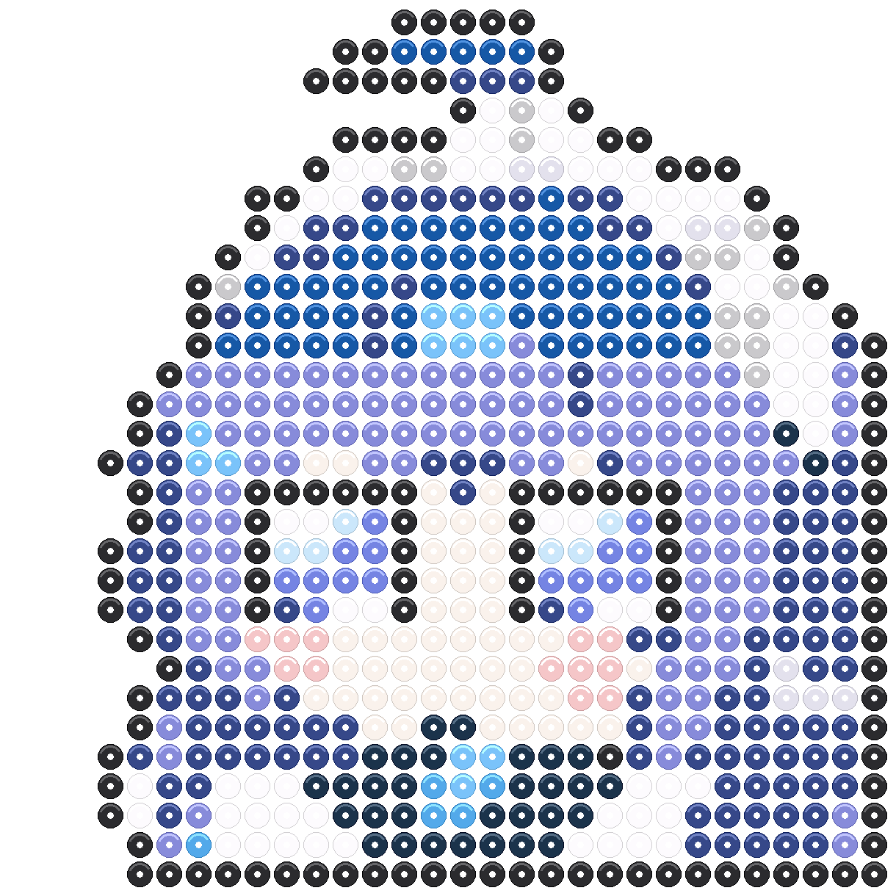
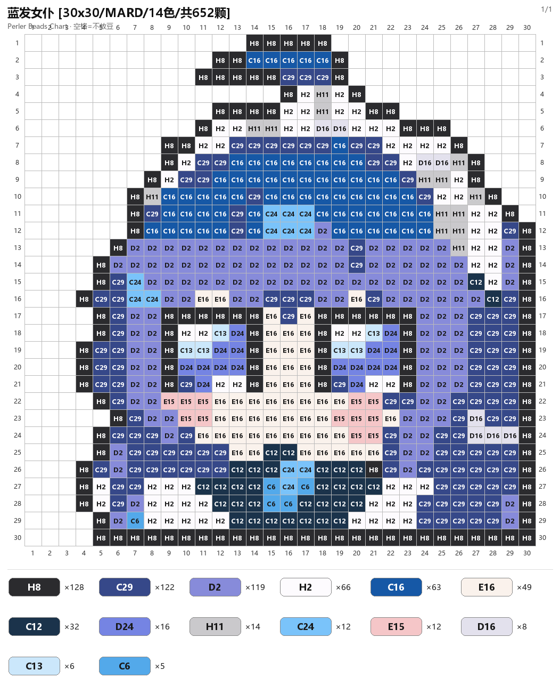
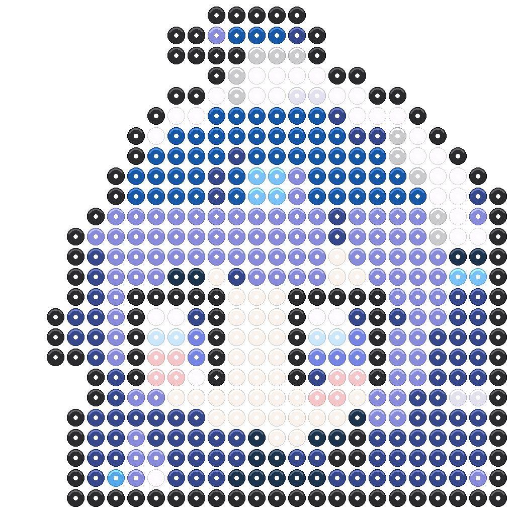
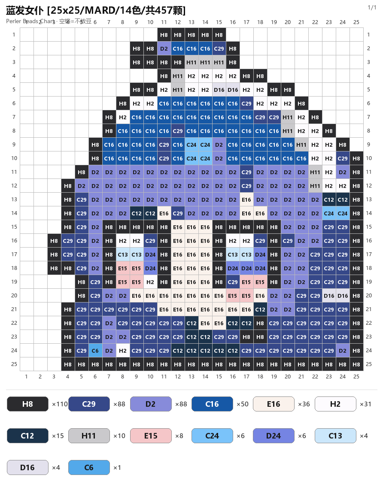

# 拼豆图纸工坊

一个面向真实手作场景的 AI Skill：把图片转换为 MARD 色号拼豆网格，并输出
可照着摆放的色号图、拼豆效果预览、CSV 网格和用量清单。

## 示例

### 30x30

| 拼豆效果 | 色号图 |
|---|---|
|  |  |

### 25x25

| 拼豆效果 | 色号图 |
|---|---|
|  |  |

## 快速开始

```bash
pip install -r requirements.txt

# 图片自动转 30x30 网格
python scripts/auto_pattern.py input.png --size 30 --name my-pattern

# 修版 CSV 后重新渲染
python scripts/render_pattern.py my-pattern_grid.csv --name my-pattern
```

## 输出

- `*_chart.png`：带行列坐标、色号与用量
- `*_preview.png`：拼豆圆片效果
- `*_grid.csv`：可编辑色号网格
- `*_summary.json`：颜色、豆数和轮廓校验

## 设计重点

自动量化的结果只是第一版。人物类图纸应继续修正眼睛、脸型、刘海、服装和
贴边轮廓。示例中的 25x25 与 30x30 图纸已经做了逐格修版，并保证最外层
可见格使用 `H8` 黑轮廓。

## 环境

- Python 3.10+
- Pillow 10+

## 许可证

MIT
